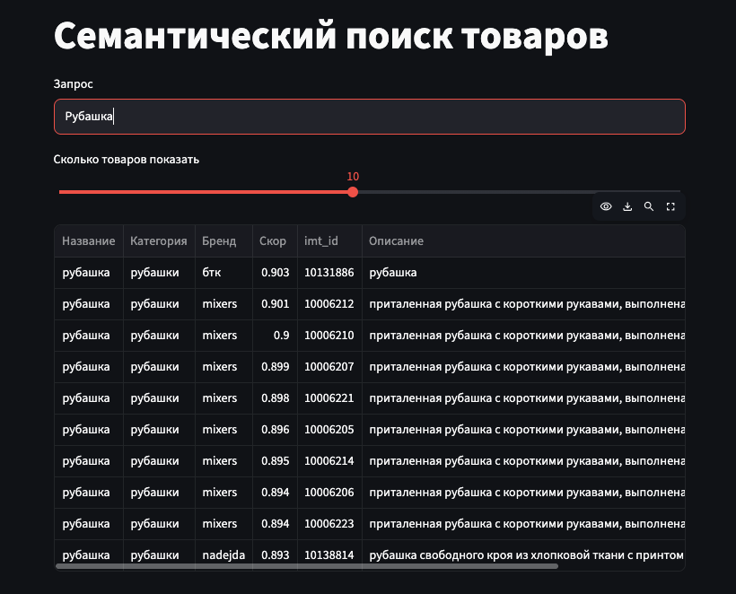

# Семантический поиск товаров

Демо на Streamlit: вводишь запрос, видишь самые подходящие товары (категории «Одежда» и «Обувь»).

**Как работает.** Модель `intfloat/multilingual-e5-small` (без дообучения) переводит запрос в вектор и сравнивает его с заранее посчитанными векторами товаров по косинусной близости. Эта конфигурация выбрана по итогам проекта: на test она лучше lexical и лучше hybrid по MRR@10 и HitRate@10.

## Запуск

Нужен Python 3.11+ и интернет (при первом запуске скачивается модель, около 470 МБ).

```bash
pip install -r requirements.txt
streamlit run app.py
```

Приложение откроется на http://localhost:8501.

## Файлы

В репозитории уже лежат данные, которые нужны приложению:

- `catalog.parquet` - каталог, одна строка на товар;
- `embeddings.npy` - векторы товаров, порядок строк как в каталоге.

Модель отдельно хранить не нужно: она не дообучалась и скачивается по имени.

## Скриншот

